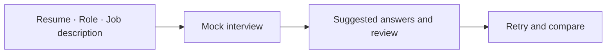

# Interview Room · 面试练习室

[简体中文](README.md) · [English](README.en.md)

A text-based interview practice workspace built around your resume, target role and job description. Answer on your own, review suggested answers based on your materials, then try again in your own words.

Runs as a Windows desktop app or a local web app, using your choice of model API and sharing saved practice records.

[Run locally](#run-locally) · [Usage](docs/usage.md) · [Implementation](docs/architecture.md)


Interface previews use sample materials and a simulated model.

## Features

- **Resume and role context**: choose a resume, target role and job description for each session. Add project notes to focus questions on your experience.
- **Two practice modes**: complete a strict simulation before viewing suggested answers, or use coach mode to review guidance as you practice.
- **Review and retry**: generate suggested answers and a session review from your materials. Keep your original response, answer again and compare improvements.
- **Knowledge and focused practice**: quick outlines across 12 technical areas, plus 48 questions with answer points and follow-ups. Edit or import notes and select materials for focused practice.
- **Multiple model connections**: save, test and switch configurations independently. Supports Responses, Chat Completions and Anthropic Messages.

Each session saves the selected materials and their versions, so later edits do not change an existing interview. React provides the practice interface, Node.js and SQLite store responses, suggested answers and retries, and Electron provides a desktop window.

## Practice flow



<details>
<summary>More views: suggested answers and knowledge library</summary>

Original responses and suggested answers stay in the same session, with expandable material references.


The knowledge library separates outlines from questions by technical area. Two themes are available: light with blue accents and dark with green accents.


</details>

## Run locally

Requires **Node.js 24.15+**. Clone the repository and start the desktop app:

```powershell
git clone https://github.com/xbzz1018/interview-room.git
cd interview-room
npm ci
npm run desktop
```

For the web app, install dependencies, then run:

```powershell
npm run build
npm start
```

Open `http://127.0.0.1:4318`. The repository also includes Windows launchers: `启动面试练习室.cmd` for desktop and `启动网页版.cmd` for the browser.

On first use, fill in a configuration name and the following fields in model settings. Save, test and enable the connection:

| Field | Value |
| --- | --- |
| API base URL | The endpoint supplied by your provider |
| Protocol | Responses, Chat Completions or Anthropic Messages |
| Model ID | A model supported by the provider |
| API key | Credentials for that service |
| Reasoning effort | Select a supported level, or use the API default |

Import your resume and job description, select a practice mode and create a session. Use `npm run package:desktop` to package the desktop app. See [Usage](docs/usage.md) for other launch options, supported material formats and data directories.

[MIT License](LICENSE)
