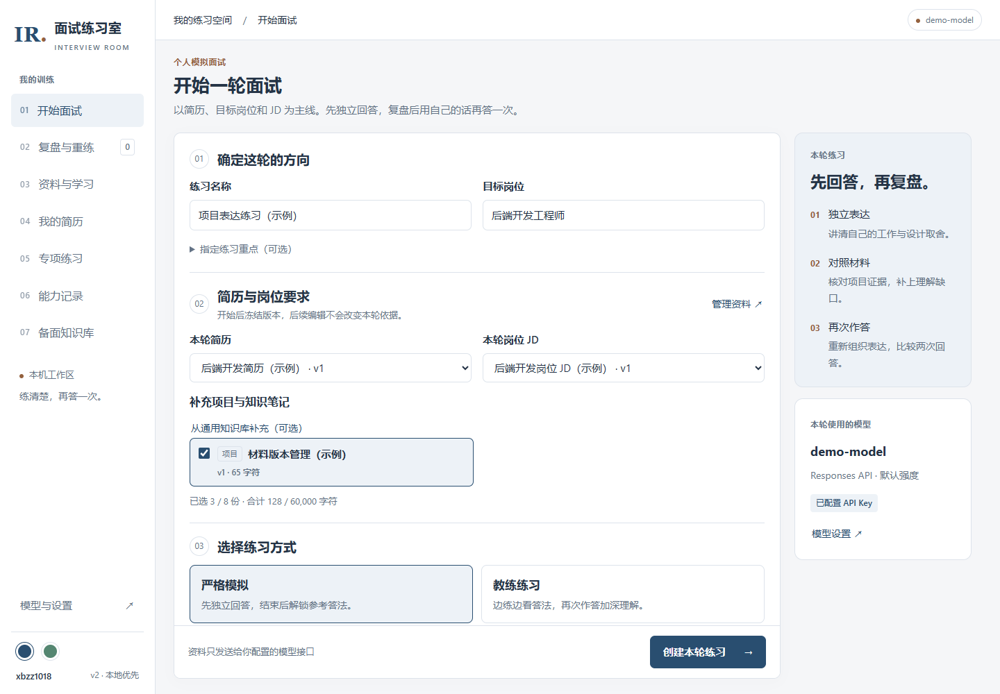
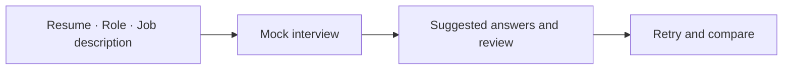
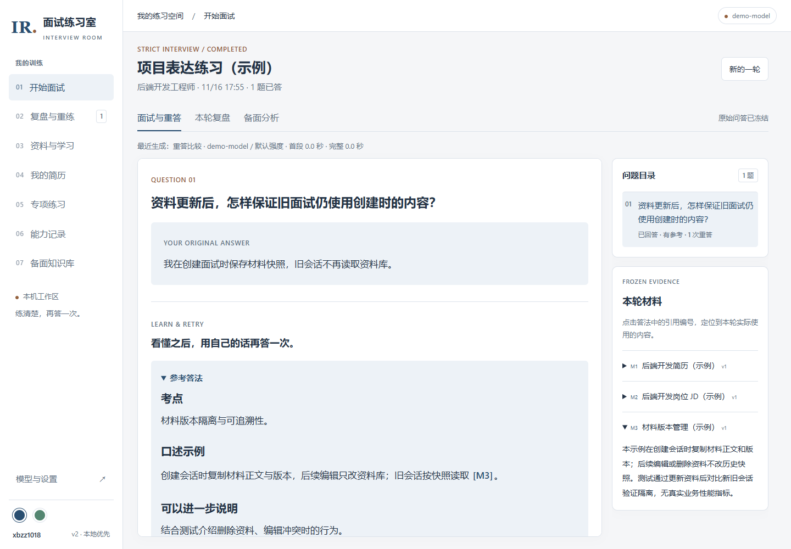
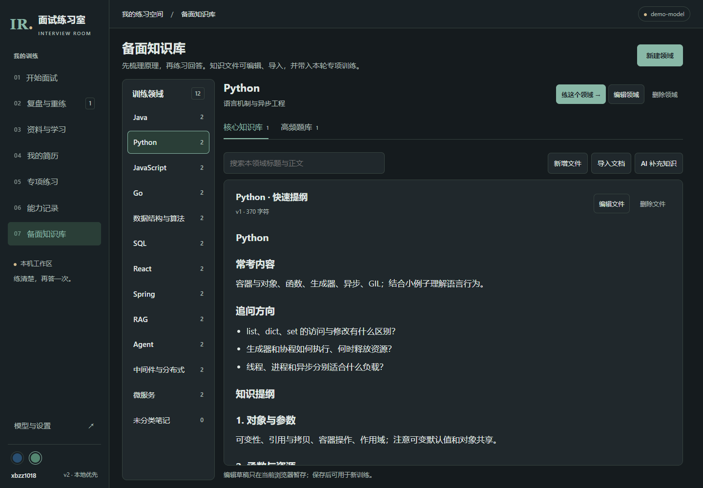
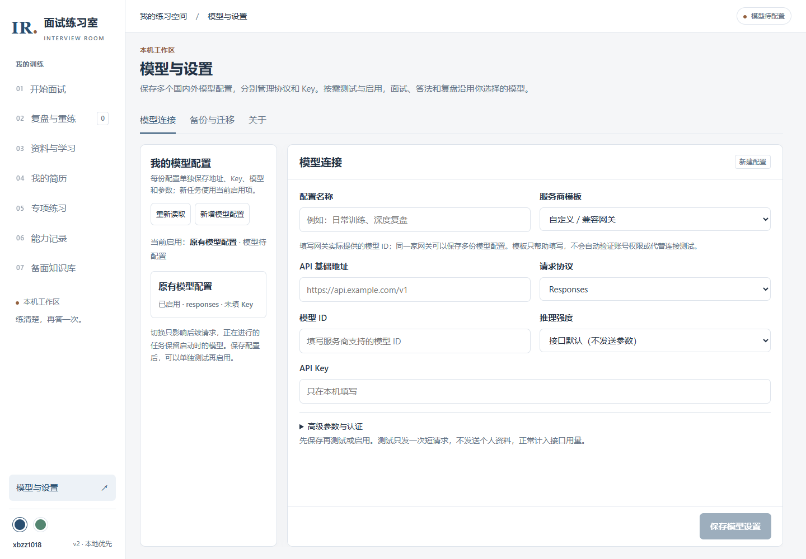

# Interview Room · 面试练习室

[简体中文](README.md) · [English](README.en.md)

A text-based interview practice workspace built around your resume, target role and job description. Answer on your own, review suggested answers based on your materials, then try again in your own words.

Runs as a Windows desktop app or a local web app, using your choice of model API and sharing saved practice records.



Interface previews use sample materials and a simulated model.

## Features

- **Resume and role context**: choose a resume, target role and job description for each session. Add project notes to focus questions on your experience.
- **Two practice modes**: complete a strict simulation before viewing suggested answers, or use coach mode to review guidance as you practice.
- **Review and retry**: generate suggested answers and a session review from your materials. Keep your original response, answer again and compare improvements.
- **Knowledge and focused practice**: quick outlines across 12 technical areas, plus 48 questions with answer points and follow-ups. Edit or import notes and select materials for focused practice.
- **Multiple model connections**: save, test and switch configurations independently. Supports Responses, Chat Completions and Anthropic Messages.

## Practice flow



<details>
<summary>More views: suggested answers, knowledge library and model settings</summary>

Original responses and suggested answers stay in the same session, with expandable material references.



The knowledge library separates outlines from questions by technical area. Two themes are available: light with blue accents and dark with green accents.



Configure your own model connection. The preview below shows an empty settings form.



</details>

## Run locally

Requires **Node.js 24.15+**. Start the desktop app:

```powershell
npm ci
npm run desktop
```

For the web app, install dependencies, run `npm run build`, then `npm start`. Open `http://127.0.0.1:4318`.

On first use, configure and test your API in the model settings page, then import your resume and job materials.

[MIT License](LICENSE)
