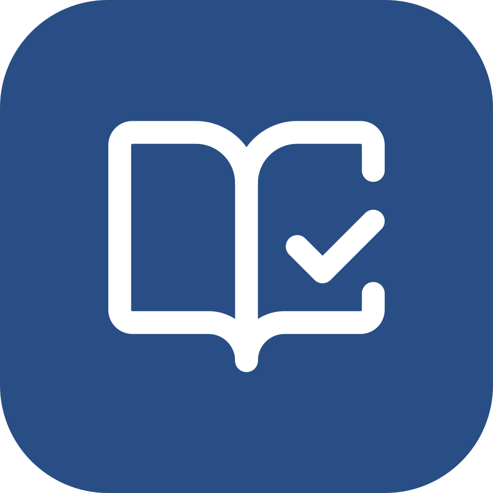
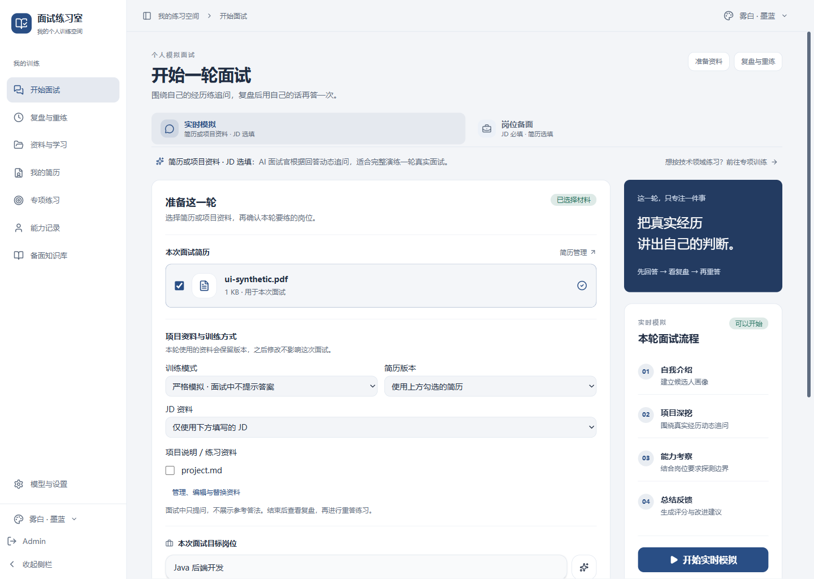
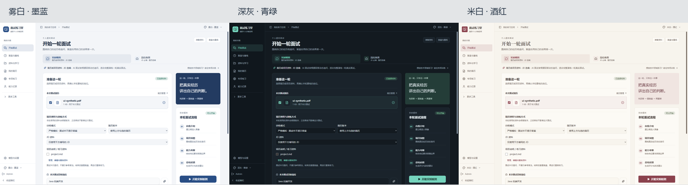

# Interview Room · 面试练习室



Personal technical interview practice using your resume, project evidence and target job description. Connect your own model API, answer independently, review the evidence and retry in your own words.

**Maintainer: @xbzz1018** · [Contributing](CONTRIBUTING.md)

[中文说明](README.md) · [Case study](docs/project-case.md) · [Roadmap](docs/project-roadmap.md) · [Attribution](NOTICE.md)



## Practice loop

1. Select the resume, JD and project materials. A session preserves their content and versions.
2. Choose a strict simulation or coaching practice. Return to an existing session to continue.
3. Read the report as it is saved; profile synchronization continues separately. Generate and cache reference answers per question.
4. Answer again and compare technical and expression gaps, with quotes checked against the original answers.

Project source snapshots can be selected before a session. Reference answers retrieve relevant snippets and expose file/line/version citations. Knowledge drafts persist in the desktop data directory across normal restarts. See the [evidence guide](docs/project-evidence.md).

The interface offers three persistent themes. Screenshots use synthetic materials and a local mock gateway.



## Development

The existing stack is TypeScript, React, Hono/Bun, SQLite and Electron. Use Bun 1.3.14 or a compatible version, with Node for frontend tests:

```bash
bun install --frozen-lockfile
bun run dev:desktop
```

Configure your own model base URL, model ID, API key and Chat Completions or Responses protocol in settings. Local ONNX or an external embedding service supports retrieval; text interviews do not require speech, recording or camera services. Historical media sessions remain available as saved records.

For a Windows personal build:

```powershell
powershell -NoProfile -ExecutionPolicy Bypass -File scripts/build-personal.ps1
```

Run `启动面试练习室.cmd` after building. Keep the full application directory. Build output and local account data are ignored by Git. No personal installer has been published.

## Validation and limits

See the Chinese README for the exact check commands. Unit, contract and isolated desktop checks verify behavior and failure handling; a mock gateway does not establish real model answer quality. High reasoning effort can still cause long waits. Interrupted report generation restarts rather than resuming tokens, and answer comparison is not yet a durable background job.

## Origin and licensing

Maintained by **xbzz1018**. [AGPL v3](LICENSE) · [Origin and changes](NOTICE.md) · [Resume module terms](frontend/src/resume/LICENSE). Resume module distribution remains a release prerequisite in the roadmap.
