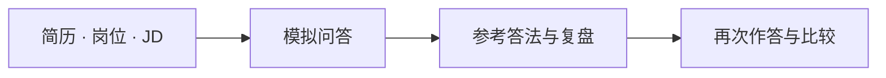

# 面试练习室 · Interview Room

[简体中文](README.md) · [English](README.en.md)

围绕简历、目标岗位和 JD 的文字模拟面试工具。先独立回答，再对照材料看参考答法，最后用自己的话重答一次。

支持 Windows 桌面与本机网页，自选模型 API，共用已保存的训练记录。

[本地运行](#本地运行) · [使用说明](docs/usage.md) · [实现设计](docs/architecture.md)

<!-- portfolio-preview:start -->
[浏览项目与交互示例](https://kukup.xbzz.cloud/projects/interview-room)


<sub>项目首页 · 示例资料与展示配色。点击上方链接，从首页继续浏览各项功能。</sub>
<!-- portfolio-preview:end -->

## 核心功能

- **简历与 JD 定向**：每轮选择简历、目标岗位和 JD，可补充项目说明与笔记，让问题围绕自己的经历展开。
- **两种训练模式**：严格模拟先完成面试，再看参考；教练练习可以边练边看，逐题梳理思路。
- **参考与重练**：结合本轮材料生成参考答法和复盘，保留原答，支持再次作答与对比改进。
- **知识库与专项练习**：内置 12 个技术领域的快速提纲，以及 48 道带参考要点和追问的题目；支持编辑、导入和选择专项材料。
- **多模型配置**：分别保存、测试和切换模型连接，支持 Responses、Chat Completions 和 Anthropic Messages。

创建练习时保存所选材料的正文与版本，后续编辑资料不会改变已有面试。React 提供练习界面，Node.js 与 SQLite 保存问答、参考答法和重答记录，Electron 提供独立桌面窗口。

## 练习流程



<details>
<summary>更多界面：参考答法与知识库</summary>

原答与参考答法放在同一轮中，材料引用可展开查看。


知识库按领域组织，提纲与题目分开。支持雾白墨蓝、深灰青绿两套主题。


</details>

## 本地运行

需要 **Node.js 24.15+**。获取源码并启动桌面版：

```powershell
git clone https://github.com/xbzz1018/interview-room.git
cd interview-room
npm ci
npm run desktop
```

网页版在安装依赖后执行：

```powershell
npm run build
npm start
```

访问 `http://127.0.0.1:4318`。也可双击仓库中的 `启动面试练习室.cmd` 或 `启动网页版.cmd`。

首次使用在「模型与设置」填写配置名称与以下参数，保存、测试并启用：

| 参数 | 填写内容 |
| --- | --- |
| API 基础地址 | 服务商提供的接口地址 |
| 请求协议 | Responses、Chat Completions 或 Anthropic Messages |
| 模型 ID | 服务商实际支持的模型名称 |
| API Key | 对应服务的调用凭据 |
| 推理强度 | 按模型选择；不支持时使用「接口默认」 |

然后导入简历和 JD，选择训练模式并创建练习。打包桌面版使用 `npm run package:desktop`；更多启动方式、材料格式与数据目录见[使用说明](docs/usage.md)。

[MIT License](LICENSE)
