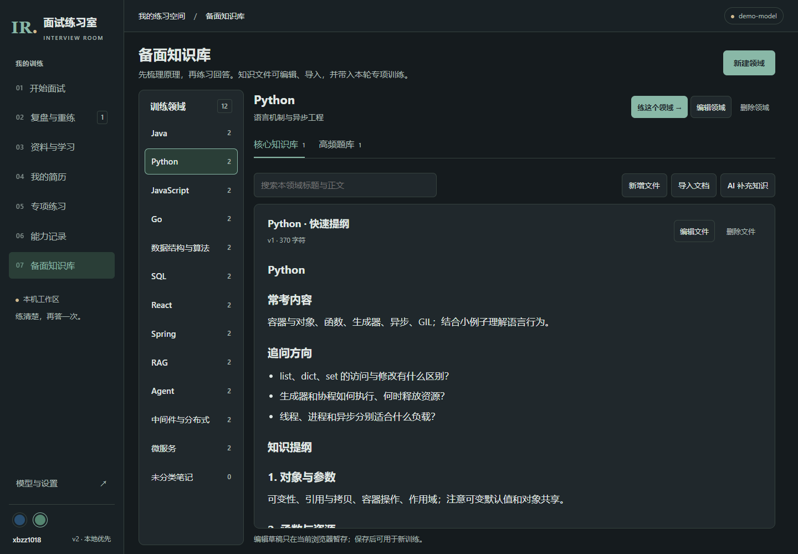

# 面试练习室 · Interview Room

[简体中文](README.md) · [English](README.en.md)

围绕简历、目标岗位和 JD 的文字模拟面试工具。先独立回答，再对照材料看参考答法，最后用自己的话重答一次。

支持 Windows 桌面与本机网页，自选模型 API，共用已保存的训练记录。


界面预览使用示例资料与模拟模型。

## 核心功能

- **简历与 JD 定向**：每轮选择简历、目标岗位和 JD，可补充项目说明与笔记，让问题围绕自己的经历展开。
- **两种训练模式**：严格模拟先完成面试，再看参考；教练练习可以边练边看，逐题梳理思路。
- **参考与重练**：结合本轮材料生成参考答法和复盘，保留原答，支持再次作答与对比改进。
- **知识库与专项练习**：内置 12 个技术领域的快速提纲，以及 48 道带参考要点和追问的题目；支持编辑、导入和选择专项材料。
- **多模型配置**：分别保存、测试和切换模型连接，支持 Responses、Chat Completions 和 Anthropic Messages。

## 练习流程


<details>
<summary>更多界面：参考答法、知识库与模型设置</summary>

原答与参考答法放在同一轮中，材料引用可展开查看。


知识库按领域组织，提纲与题目分开。支持雾白墨蓝、深灰青绿两套主题。



模型连接自行配置，以下为空白设置示例。


</details>

## 本地运行

需要 **Node.js 24.15+**。启动桌面版：

```powershell
npm ci
npm run desktop
```

网页版在安装依赖后执行 `npm run build`、`npm start`，访问 `http://127.0.0.1:4318`。

首次使用在“模型与设置”中填写并测试 API，再导入自己的简历与岗位资料。

[MIT License](LICENSE)
