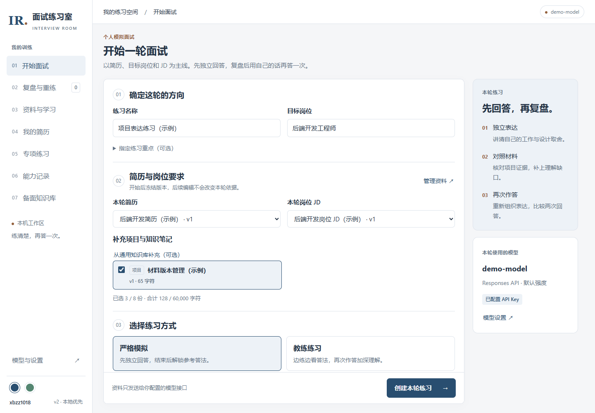
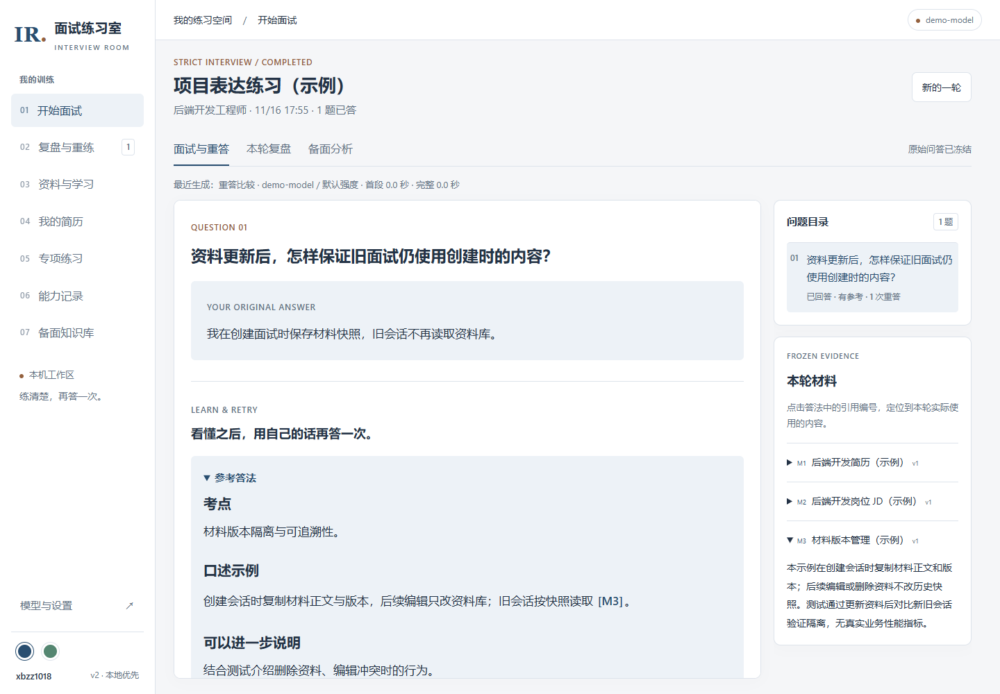
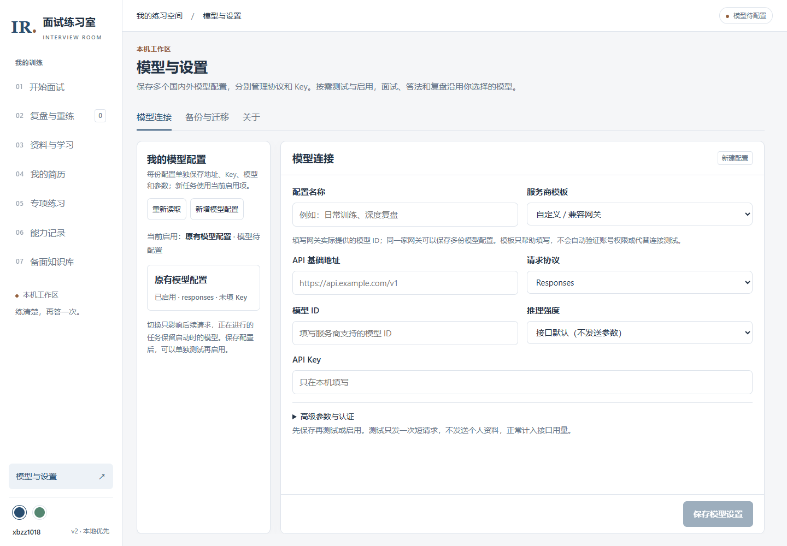

# 面试练习室 · Interview Room

围绕自己的简历、目标岗位和 JD 练技术面试。先独立回答，再对照材料看参考答法，最后用自己的话重答一次。

由 [xbzz1018](https://github.com/xbzz1018) 设计与维护。Windows 桌面与本机网页共用已保存的训练记录，自选模型 API。



所有截图来自实际运行的隔离示例工作区，使用合成资料和模拟模型；截图中的生成耗时不代表真实模型速度。

## 从一次问答，到一次改进

很多练习停在“看懂答案”。面试练习室把原答、参考和重答放在同一轮里，让下一次表达有具体的改进依据。


- 本轮材料保留正文和版本。更新简历或项目资料后，旧面试仍使用当时的依据；参考中的引用可以展开查看。
- 严格模拟结束后解锁答法；教练练习可边练边看。重答单独保存，保留最初的独立表达。
- 12 个通用技术领域各有一份快速提纲，另附共 48 道带参考要点与追问的题目。可以编辑、导入笔记，再选择相关内容做专项练习。
- 多份模型配置分别保存、测试和启用，支持 Responses、Chat Completions 与 Anthropic Messages。切换配置只影响后续任务。

<details>
<summary>查看重答练习、知识库与空白模型设置</summary>

参考答法帮助梳理考点，重答比较回到自己的原话。界面保留原答，不用新回答覆盖过去的记录。



知识库按领域组织，快速提纲与题库分开。雾白墨蓝、深灰青绿两套主题可切换。


新用户自行填写服务商地址、模型与 Key；下图为空白配置示例。



</details>

## 工程取舍

React + TypeScript 构建界面，Node.js 提供本机服务，SQLite 保存材料、会话和生成任务，Electron 提供独立桌面窗口。

| 需要解决的问题 | 实现与取舍 |
| --- | --- |
| 复盘时依据已经变化 | 创建会话时复制材料正文与版本，历史引用不依赖当前资料库 |
| 重复提交或取消后迟到的结果 | 请求标识去重，生成时捕获会话版本；取消和过期结果不能写入会话 |
| 关闭应用后找不到生成进度 | 保存输出片段与任务状态，重启后标为中断，手动重试 |
| 桌面与网页各存一套记录 | 核对本机工作区身份后复用同一服务；桌面退出只关闭自己创建的服务 |
| 为少量材料维护检索服务成本过高 | 直接使用选定材料全文，无需 Embedding；每轮最多 8 份、60000 字符 |

实现位置与失败处理见 [架构说明](docs/architecture.md)。

## 本地运行

需要 **Node.js 24.15+**。在仓库目录执行：

```powershell
npm ci
npm run desktop
```

网页版执行 `npm run build` 后运行 `npm start`，访问 `http://127.0.0.1:4318`。首次使用进入“模型与设置”填写并测试自己的 API。Windows 也可使用仓库内的两个启动 CMD。

桌面打包、模型参数、资料格式与备份见 [使用与构建](docs/usage.md)。已有 V1 数据请先阅读 [迁移说明](docs/migration.md)。

## 验证与边界

```powershell
npm run check         # 后端回归、类型检查与生产构建
npm run test:ui       # Microsoft Edge 浏览器流程
npm run test:desktop  # Electron 桌面流程，需先 build:desktop
```

[验收记录](docs/acceptance.md) 区分了合成测试与实际模型评估。应用供个人本机使用；API Key 明文存于本机数据库，所选材料会发送到你配置的模型。未保存草稿留在当前浏览器来源，桌面与网页分别保存草稿。

当前提供文字训练和 Windows 桌面文件夹版。自动能力画像、向量检索、安装器与自动更新尚未提供；实际回答质量和速度取决于模型与材料。

[功能范围](docs/scope.md) · [MIT](LICENSE) · [依赖许可](DEPENDENCIES.md) · [版本说明](NOTICE.md)
