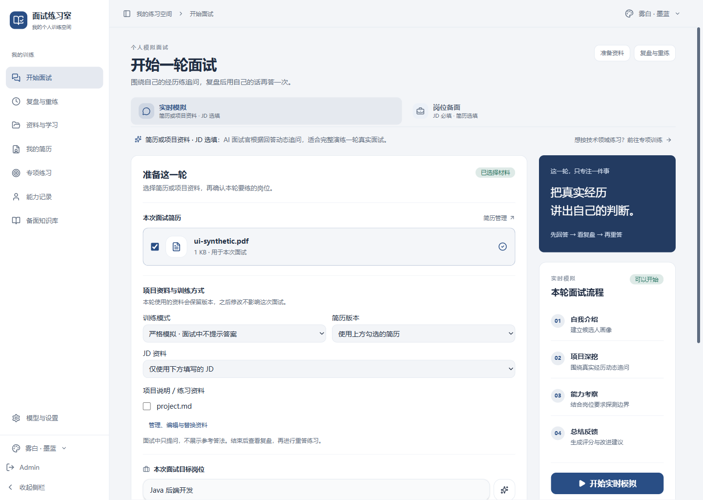
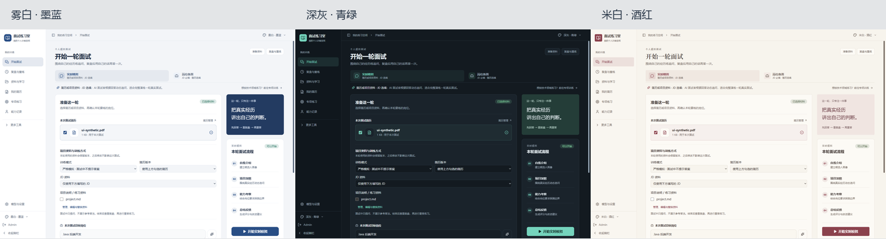

# 面试练习室 · Interview Room


把自己的简历、项目材料和目标岗位变成一轮可以复盘、重答的技术面试。接入自己的模型 API，先练独立表达，再根据原话证据改进下一次回答。

**个人维护：@xbzz1018** · [工程案例](docs/project-case.md) · [开发与贡献](CONTRIBUTING.md)



截图使用合成资料和模拟网关。

## 一轮练习

1. **准备**：选择简历、JD、项目资料与源码/题卡、目标岗位及训练模式，开始时冻结材料版本。
2. **模拟**：严格模拟先独立作答；教练练习可主动请求提示。切回页面可继续原会话。
3. **复盘**：报告逐段保存，正文先读，画像后台同步。逐题生成并缓存参考答法。
4. **重答**：再次作答，比较原回答和新回答，分别记录技术缺口与表达练法。

| 工程问题 | 当前实现 |
| --- | --- |
| 更新资料影响旧面试依据 | 会话保留材料内容与版本，不回写历史快照 |
| 编辑失败丢失原资料 | revision 冲突检查，解析与向量化成功后再事务提交，失败保留原文件 |
| 参考答法不知道源码依据 | 本轮项目版本内检索，引用可展开查看文件、行号与片段 |
| 关闭软件丢失知识草稿 | 桌面主进程保存草稿，正常重启与端口变化后恢复 |
| 看过参考答案仍然不会表达 | 单独保存重答，缺口引用原话，不覆盖原始问答或成绩 |
| 断线后重复调用、离页看不到进度 | 请求标识去重、答法缓存、会话恢复和报告分阶段展示 |
| 模型参数在不同功能中不一致 | 兼容/Responses 适配，测试和调用共用配置，不自动更换模型或强度 |

实现位置、设计取舍与验证方法见 [训练闭环案例](docs/project-case.md)。

## 三套配色

雾白墨蓝、深灰青绿、米白酒红可从顶部、侧栏或设置切换。自动保存，桌面重启或本机端口改变后仍保留。



主要入口是面试、复盘、资料、简历、专项、能力记录和备面知识库。

## 技术栈

| 层次 | 技术与职责 |
| --- | --- |
| 界面 | React、TypeScript、Vite、Tailwind；表单、问答流与训练记录 |
| API | Hono、Bun；REST/SSE 与契约校验 |
| 业务 | TypeScript 用例、状态机和端口；材料、面试、复盘与重答规则 |
| 数据 | SQLite、文件存储；会话、资料版本与可重建向量 |
| 模型 | OpenAI 兼容/Responses；本地 ONNX 或外部 Embedding |
| 桌面 | Electron + 编译 Bun sidecar，同源界面与本机动态端口 |

## 运行与构建

使用锁定的 Bun `1.3.14` 或兼容版本，Node 用于前端测试：

```bash
bun install --frozen-lockfile
bun run dev:desktop
```

首次进入填写自己的模型基础地址、模型 ID 和 API Key，支持 Chat Completions 与 Responses 网关。无需固定厂商或固定模型。

本地 Embedding 用于资料检索和长期记忆，简历模拟读取所选材料全文；首次使用本地向量需要下载模型。文字模拟无需音视频服务。见 [设置](docs/settings.md) 与 [外部服务](docs/external-services.md)。

Windows 个人包：

```powershell
powershell -NoProfile -ExecutionPolicy Bypass -File scripts/build-personal.ps1
```

构建后运行 `启动面试练习室.cmd`。程序在 `dist/desktop-interview-room/win-unpacked/`，个人数据在 `local_tools/personal-data/`，均不进入 Git。完整程序目录需要一起保留。当前尚未发布个人版安装包。

## 功能范围

只保留文字模拟面试、简历/JD 与项目资料、专项练习、复盘、参考答法、重答和能力记录。录音复盘、实时语音辅助、音视频采集及知识图谱页面已移除；无需语音或录音上传服务。历史数据保留，原有记录可查看。

## 验证

```bash
bun run typecheck
bun run typecheck:node
bun run check:boundaries
bun run test
bun run check:frontend
bun run smoke:personal-desktop
```

最后一项需要已打包的 Windows 客户端和缓存的中文 Embedding，创建隔离合成账号并使用本机模拟网关。模拟流程与测试数量不能代替真实模型质量评估。

## 当前限制与下一步

- 高推理强度和网关时延仍可能使报告等待一两分钟；分阶段展示不保证推理加速。
- 未完整生成的报告重启后需要重新生成，重答尚未作为可恢复后台任务运行。
- 知识库草稿在桌面正常重启后可恢复；只有点击保存后的知识内容参与训练。写入失败会提示备份，强制断电前的在途写入不作保证。
- 项目证据通过明确清单导入，按问题关联源码/题卡；更新文件后需重新导入，尚无目录监听或历史答法重生成版本。见 [证据使用指南](docs/project-evidence.md)。
- 资料旧版本暂留，无版本回滚界面。每轮最多 8 份资料库文档、48000 字，连同默认简历最多 60000 字。
- 模型可能给出错误建议；未知职责和数字应标为待补充，参考解法不能代替真实经历。
- 已运行小规模合成场景真实模型检查；完整 20 场景盲评、真实资料召回基准及跨平台实测仍待完成。

见 [项目案例](docs/project-case.md)、[架构与选型](docs/typescript-backend-architecture.md)、[改进计划](docs/project-roadmap.md) 和 [个人产品实施计划](docs/personal-project-plan.md)。

## 来源与许可

[AGPL v3](LICENSE) · [来源与修改说明](NOTICE.md) · [简历模块条款](frontend/src/resume/LICENSE)。简历模块的分发事项见改进计划。
