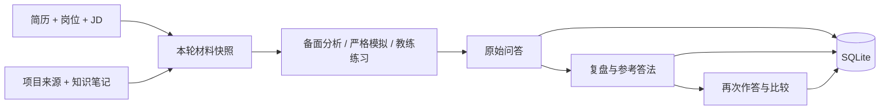

# 实现取舍

更新：2026-11-16。产品由 xbzz1018 维护。目标是保留可用的文字面试闭环，以更少的运行组件支撑个人练习。

## 为什么保持 TypeScript

前后端共享会话和任务类型。React 负责界面，Node 内置 HTTP、fetch 和 SQLite 负责本机服务，不再要求 Bun、单独的向量服务或账户服务器。没有为改名字而换语言。

## 如何围绕本人材料

简历和 JD 分别标记类型。每轮只选一个版本；JD 是招聘要求，项目和笔记作为补充依据。目标岗位由使用者填写，没有简历或 JD 时也可练习岗位通用知识。创建会话复制正文和版本，此后改动或删除资料不回写旧会话。出题与反馈随本轮内容调整，不设置固定口述时长、中文字数或练习条数。

选材全文上限 60000 字符，最多 8 份。不需要下载 Embedding、切块或重建索引；材料长时速度与成本可能上升，适合使用聚焦摘要和相关来源。尚无独立源码检索服务。

## 状态与失败

正式记录保存在 SQLite WAL 中。提交原答检查会话 revision，资料编辑检查材料 revision；过期写入报冲突，不覆盖现有内容。任务由 session + requestId 去重，同一个逻辑请求不能改内容，一轮只允许一个生成任务。

任务保留输出片段、模型、推理强度和耗时。取消后的迟到结果不落入会话。重启将未完成任务改为中断，保留片段，由用户决定是否重新调用。成功任务与会话结果在同一事务提交。

Responses、Chat 与原生 Anthropic Messages 分别组装路径、认证和参数。Claude 只展示文字块，忽略内部思考片段，合法停止原因和 message_stop 都到达才计成功。Chat 可按接口选择输出上限字段，不支持的推理参数可明确不发送。流未完整结束不计成功；错误不原样回显上游正文。推理强度不静默降低。模型调用次数减少和流式展示并不能保证模型推理更快。

## 领域知识如何进入训练

领域与知识文件分别保存在 records 的 topics 和 materials 集合。知识文件标记 core 或 questions，普通笔记保留未分类入口。首次启动写入 12 领域、12 份快速提纲和 12 份问答文件，使用 knowledge-starters-v1 标记，重启不恢复删除。提纲按常考内容、追问方向和知识分组组织；用户自行增加多份文件时才显示阅读选择器。旧内置提纲仅在正文哈希、标题与分类完全匹配已知版本时更新，保留用户编辑与历史快照。搜索覆盖当前领域及分类的标题与正文，没有额外向量服务。

创建专项时校验所选文件确属当前领域，按核心知识与高频题分别合并，正文注明各文件标题和版本，随后与简历、JD、项目一起冻结。本轮最多 8 份、60000 字符，超限拒绝并提示调整；不默默丢掉知识。综合面试默认不堆入整套通用知识，可由使用者主动选取相关文件。

知识生成按领域去重和互斥，使用启动时的模型及已有知识。完成后检查领域版本，新建一份需核对的 AI 文件；取消、失败、重启中断均不覆盖原内容。删除领域会将文件移至未分类，面试快照独立保留。

## 多配置与切换

每个模型 profile 保存独立 connection，页面只读到 hasApiKey。新工作区的地址、模型、推理强度和凭据均为空。当前启用 ID 存于 meta，主题单独更新；主题操作不会回写旧浏览器副本中的模型参数。旧配置首次迁移为 profile-default，保留原连接。新建不复制 Key，编辑 Key 留空时沿用，显式空串才清除。启用不修改配置 revision，也不改变正在运行任务捕获的连接。

模型配置不进入文字备份。任务只记录模型、强度、配置 ID/名称与耗时，错误脱敏使用任务启动时的 Key，避免切换后漏掉旧凭据。服务商模板仅为填写入口，各模型实际支持的参数和权限仍需使用者核对并测试。

## 本机边界

桌面使用 Electron 隔离窗口，页面无 Node 权限、不暴露 IPC，只访问本机 HTTP 服务；拒绝远程导航、新窗口及摄像头等权限。内嵌 Node 的 SQLite 直接运行打包后的服务，无需另装 Node。项目开发模式与项目启动脚本默认使用项目 data；发行文件夹版默认使用独立 userData/interview-room-v2 的数据目录，可用 --data-dir 指定工作区。

浏览器和桌面连接同一端口前，核对 app 标识与经过真实目录规范化后的 SHA256 workspaceId。已有服务只连接，不接管其生命周期；由桌面创建的服务在退出时取消生成、关闭数据库并释放实例锁。打包白名单仅包含前端产物、桌面入口、后端 bundle、生产依赖和许可证，个人数据及开发目录不打包。Electron 运行时声明随文件夹版保留。

服务只监听 127.0.0.1，检查 Host、Origin 和进程随机访问令牌。数据目录有实例锁，避免重复启动先把另一进程任务标为中断。这里是个人本机应用，不是供多用户共享的互联网服务。

API Key 明文位于本机数据库；文字备份不包含它。图片只在用户确认后发给所配置的模型，PDF/DOCX 在本机解析。DOCX 只读取主正文 XML，限制解压大小并验证校验和，不执行宏、外部实体或链接。草稿目前使用浏览器 localStorage，固定端口下可恢复；换浏览器或来源不能保证恢复。

## 验证边界

引用校验只判断 [M数字] 属于本轮，不能保证每句话都有证据、比较引文准确或技术结论正确。未实现跨轮评分与画像，不能用自动分数替代真实表达训练。真实网关的速度、稳定性和回答质量需要单独评估。
