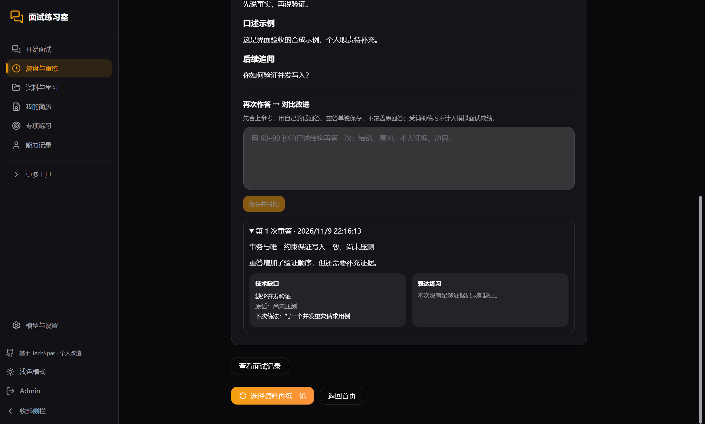

# 怎样用复盘结果继续练习

更新日期：2026-11-09，适用于“面试练习室”个人版。

## 先拿一道题练清楚

1. 从“复盘与重练”打开已结束的面试，先读原问答和报告，确定是知识缺口、论证缺口，还是表达不清。
2. 在“逐题参考答法”选择一道卡住的问题。查看考察意图和回答框架，再核对口述示例中的职责、数据是否真实。未知个人事实应补充或删去。
3. 用自己的话再次作答，补充原理、取舍和验证，而不是复制示例。
4. 保存并对比，检查改进点、仍有的技术缺口与表达练习。每项观察应有回答原文作为依据。
5. 只选一项具体练法完成，再回到“开始面试”确认材料与模式，练下一轮。

已保存的重答与比较保留在原会话中，“开始面试”页也会聚合最近的技术与表达练习记录，并链接到原会话。观察不自动成为永久能力标签。

以上为实际桌面界面的合成资料验收截图，回答与比较由模拟网关提供，用于验证保存、恢复和展示流程。

## 分数说明

| 指标 | 含义与限制 |
| --- | --- |
| 单场平均分 | 通常为 10 分制，反映该场已有评分，不保证是客观能力测量 |
| 长期掌握度 | 通常为 100 分制，用于观察领域趋势，不能与单场平均分直接比较 |
| 教练练习 | 保留学习观察，不计入独立作答分数趋势或掌握度 |
| 再次作答 | 属于参考后练习，不修改原回答、原成绩或冒充独立作答结果 |

## 报告和画像分别看

报告正文可以先读，画像同步在后台完成。页面显示画像失败时，保留已有报告并提供单独重试入口。任务通知完成表示报告可读，不表示画像一定已经同步结束。

在“能力记录”中观察多场结果是否反复出现同一问题，再决定做专项练习还是补充项目证据。模型观察可能不准确，应回到对应原话核对。

严格模拟中不提前展示答法；教练练习则允许请求提示和讲解。两类场次目的不同，不能混在一起判断独立应答水平。语音表达与真实面试体验尚未完成全套真人质量评估。
